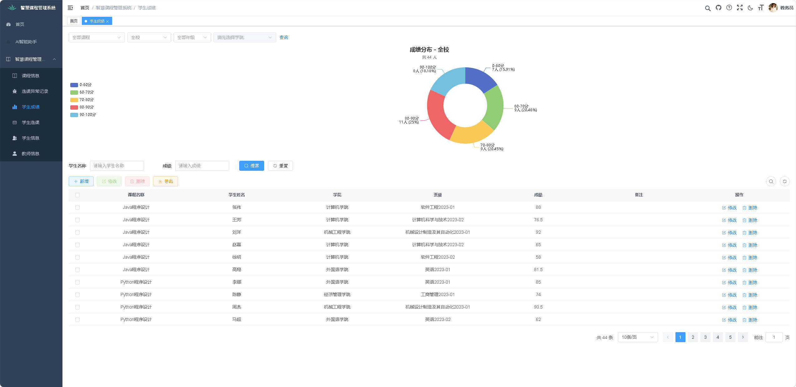
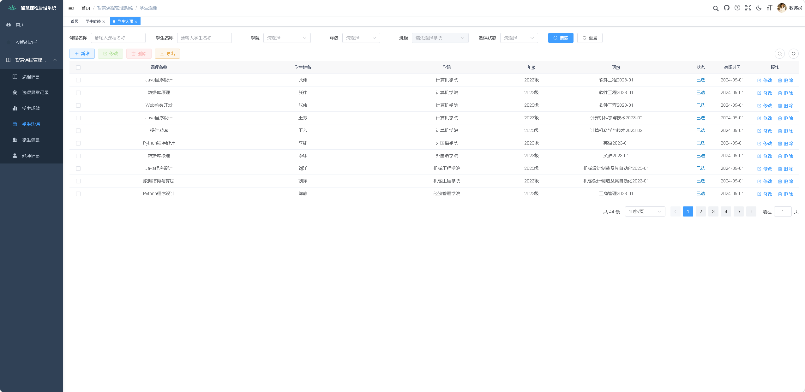
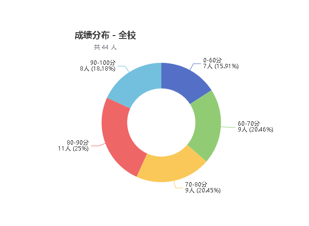
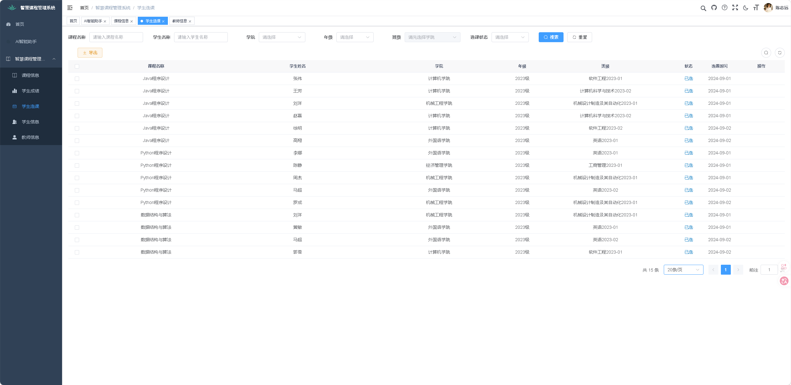
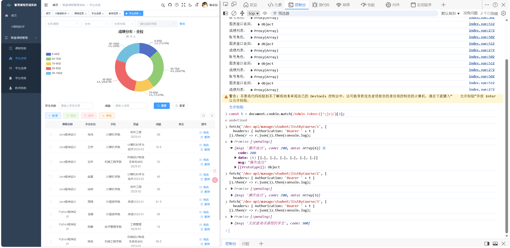

# 智慧课程管理系统

> 基于 **RuoYi-Vue 3.9.0** 二次开发的高校选课与成绩管理平台，实现**管理员 / 教务 / 教师 / 学生四级角色 + 行级数据隔离**，支持公网部署。


---

## 一、项目简介

本项目面向高校选课与成绩管理场景，在若依前后端分离框架基础上完成业务二次开发，重点解决**多角色数据隔离**问题：不同角色登录后看到的数据范围不同，且限制落在**接口层**而非仅前端隐藏按钮——即使直接调用接口也无法越权取数。

核心能力：

- **6 张业务表**：学生、教师、课程、选课、成绩、选课异常
- **4 类角色**：管理员（admin）、教务员（manage）、教师（teacher）、学生（student）
- **行级数据权限**：教师只能看到自己授课课程下的学生与成绩；学生只能看到自己的选课与成绩
- **统一响应与异常处理**：全局异常拦截，统一 `AjaxResult` 返回结构，异常堆栈不对外暴露
- **完整部署链路**：阿里云 ECS + Nginx 反向代理 + Jar 后台运行

## 二、功能模块

| 模块 | 主要功能 | 管理员 | 教务员 | 教师 | 学生 |
| --- | --- | :---: | :---: | :---: | :---: |
| 学生管理 | 学生信息增删改查、按课程查学生 | ✅ | ✅ | 仅本人课程 | ❌ |
| 教师管理 | 教师信息维护、关联系统用户 | ✅ | ✅ | ❌ | ❌ |
| 课程管理 | 课程开设、授课教师绑定 | ✅ | ✅ | 查看本人课程 | ❌ |
| 选课管理 | 学生选课、退课、选课记录查询 | ✅ | ✅ | 仅本人课程 | 仅本人记录 |
| 成绩管理 | 成绩录入、修改、查询、分数段统计 | ✅ | ✅ | 仅本人课程 | 仅本人成绩 |
| 选课异常 | 选课异常记录登记与处理 | ✅ | ✅ | ❌ | ❌ |
| 统计分析 | ECharts 成绩分数段环形图，按课程 / 学院 / 班级三维筛选 | ✅ | ✅ | 仅本人课程 | ❌ |

> 权限的完整设计说明见 [docs/PERMISSION.md](docs/PERMISSION.md)

## 三、权限设计（核心）

采用**三层校验**，逐层收紧：

1. **角色级**：`@PreAuthorize("@ss.hasPermi('manage:score:list')")`，由若依权限框架按角色 - 菜单 - 按钮粒度拦截；
2. **接口级归属校验**：进入业务逻辑前比对资源归属，例如「按课程查询学生」接口会比对 `course.teacherId` 与当前登录教师，不一致直接返回 `无权查询该课程的学生`；
3. **数据级过滤**：Service 层按角色拼装查询条件——教师先按 `teacher_id` 查出其授课课程 ID 集合，再以 `IN` 条件过滤成绩与选课记录；**教师无授课课程时直接返回空集合**，避免条件缺失导致全量数据泄露。

## 四、技术栈

| 层次 | 技术选型 |
| --- | --- |
| 后端框架 | Spring Boot 2.5.15、Spring MVC、Spring Security、JWT |
| 持久层 | MyBatis（XML 映射 + 动态 SQL）、PageHelper 分页、Druid 连接池 |
| 数据库 | MySQL 8.0（多表关联、索引优化） |
| 缓存 | Redis（登录令牌、字典与参数缓存） |
| 定时任务 | Quartz |
| 前端 | Vue 3、Vite、Element Plus、Pinia、ECharts、Axios |
| 部署 | 阿里云 ECS（Ubuntu）、Nginx 反向代理、Jar 包部署 |
| 扩展 | DeepSeek 大模型接口（AI 智能问答） |

## 五、系统截图

> 截图存放于 `docs/images/`，按以下文件名引用即可自动显示（截图清单见 [docs/images/README.md](docs/images/README.md)）

| 登录页 | 成绩管理 |
| --- | --- |
|  |  |

| 选课管理 | 成绩分数段统计 |
| --- | --- |
|  |  |

| 教师数据隔离 | 越权拦截提示 |
| --- | --- |
|  |  |

## 六、目录结构

```
RuoYi/
├── backend/                    # 后端（Maven 多模块）
│   ├── ruoyi-admin/            # 启动模块（RuoYiApplication、AiController）
│   ├── ruoyi-common/           # 通用工具、统一响应、Redis 封装
│   ├── ruoyi-framework/        # 框架核心（Security、AOP、全局异常处理）
│   ├── ruoyi-generator/        # 代码生成器
│   ├── ruoyi-manage/           # 业务模块（学生/教师/课程/选课/成绩/选课异常）
│   ├── ruoyi-quartz/           # 定时任务
│   ├── ruoyi-system/           # 系统模块（用户/角色/菜单/字典/参数）
│   └── sql/                    # 数据库脚本
└── frontend/                   # 前端（Vue3 + Vite）
    └── src/views/manage/       # 业务页面
```

## 七、快速开始

### 1. 初始化数据库

新建数据库 `smart_course_management`（字符集 `utf8mb4`），导入：

```bash
backend/sql/smart_course_management.sql   # 完整库脚本（系统表 + 业务表）
backend/sql/quartz.sql                    # 如需定时任务功能再执行
```

### 2. 启动后端

```bash
cd backend/ruoyi-admin/src/main/resources
# 复制模板并填写自己的配置
cp application-druid-example.yml application-druid.yml
cp application-example.yml       application.yml   # 修改 token.secret

# 回到 backend 目录，用 IDEA 打开等待 Maven 依赖下载后运行
# 启动类：com.ruoyi.RuoYiApplication
```

后端地址：`http://localhost:8080`

### 3. 启动前端

```bash
cd frontend
npm install
npm run dev
```

前端地址：`http://localhost:8081`

> 默认账号：`admin / admin123`（首次登录后请立即修改）

### 4. 生产构建

```bash
cd frontend && npm run build:prod   # 产物在 frontend/dist/
```

## 八、测试与验证

项目在开发过程中完成了接口自测，覆盖**正常流程、权限越权、异常返回、边界值**四类场景，用例与结论见 [docs/TEST.md](docs/TEST.md)。

重点关注：

- 教师跨课程取数是否被拦截
- 教师无授课时是否返回空集（而非全量）
- 未登录 / 无权限角色访问接口的返回是否符合预期
- 分页与权限过滤叠加后数据是否仍然正确

## 九、部署

ECS / 本地服务器部署步骤（JDK、MySQL、Redis、Nginx、Jar 后台运行、反向代理、安全组）见 [docs/DEPLOY.md](docs/DEPLOY.md)。

## 十、扩展：AI 智能问答

`ruoyi-admin` 内置 `AiController` + `DeepSeekChatService`，通过大模型 API 提供课程与成绩相关的智能问答能力。

> 使用前请在配置文件中填写自己的 API Key，**切勿将密钥提交到仓库**。

## 十一、隐私与安全说明

| 文件 | 处理方式 | 原因 |
| --- | --- | --- |
| `application.yml` | 不上传，仅上传 `application-example.yml` | 含 token 密钥、本地路径 |
| `application-druid.yml` | 不上传，仅上传 `application-druid-example.yml` | 含数据库账号密码 |
| `frontend/node_modules/` | 不上传 | clone 后 `npm install` 生成 |
| `backend/**/target/` | 不上传 | Maven 编译产物 |
| 数据库备份 / 含真实数据的 dump | 不上传 | 可能含用户隐私数据 |

## 十二、常见问题

**Q：clone 后启动报数据库连接失败？**
A：确认已复制 `application-druid-example.yml` 为 `application-druid.yml` 并填好账号密码，MySQL 已启动且脚本已导入。

**Q：启动报 Redis 连接失败？**
A：本项目强依赖 Redis（登录令牌与参数缓存），请先启动本地 Redis（默认 `localhost:6379`、无密码）。

**Q：`npm install` 很慢？**
A：切换镜像 `npm config set registry https://registry.npmmirror.com`。

## 十三、更新日志

| 版本 | 内容 |
| --- | --- |
| v1.2 | 完善行级数据权限（教师 / 学生维度），修复权限过滤与分页叠加失效问题；补充接口自测文档 |
| v1.1 | 修复全局异常处理，统一接口返回结构；补充数据库完整脚本 |
| v1.0 | 基于 RuoYi-Vue 3.9.0 完成 6 张业务表与 4 类角色的基础功能 |

## License

MIT License（基于若依开源框架二次开发，保留原框架 License 声明）
